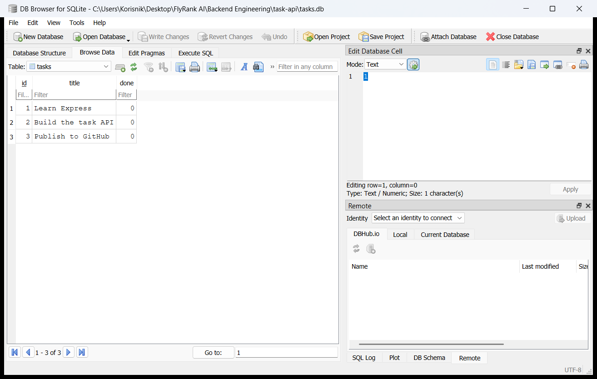

# Task API

A small to-do API. You can create, read, update, and delete tasks. Tasks are stored in a SQLite file named `tasks.db`. They stay after the server restarts.

## Why SQLite

SQLite is one file on disk. There is no separate database server to install. The file is created the first time the app starts. That is why a restart no longer drops the tasks.

The file is `tasks.db`, next to `server.js`. It is listed in `.gitignore`, so a clone does not include someone else's tasks. On the first start the app creates the file, the `tasks` table, and three example tasks.

Those three inserts run in one transaction. If the process stops halfway, the table does not keep a partial seed. The next start still sees an empty table and inserts all three.

## Postgres server

The database server is Postgres, running in Docker. It is not installed on the machine. Start it with:

```bash
docker run --name taskdb -e POSTGRES_PASSWORD=dev -e POSTGRES_DB=tasks -p 5432:5432 -v taskdata:/var/lib/postgresql/data -d postgres:16
```

The image is `postgres:16`. The volume `taskdata` keeps the rows after the container stops. `docker ps` shows it running. `docker exec -it taskdb psql -U postgres -d tasks` opens the SQL prompt.

## Run

One command after install:

```bash
npm install
npm start
```

`.npmrc` turns off install scripts. `better-sqlite3` already includes a Windows build, so npm does not need to compile it.

The server listens at [http://localhost:3000](http://localhost:3000).

Swagger UI is at [http://localhost:3000/docs](http://localhost:3000/docs).

To start clean, delete `tasks.db` and run `npm start` again. The three example tasks come back.

## Endpoints

| Method | Path | Success | Failure |
| --- | --- | --- | --- |
| GET | `/` | 200, API name and version | |
| GET | `/health` | 200, `{ "status": "ok" }` | |
| GET | `/tasks` | 200, the full list | |
| GET | `/tasks/:id` | 200, one task | 404 if the id is unknown |
| POST | `/tasks` | 201, the created task | 400 if `title` is missing or blank |
| PUT | `/tasks/:id` | 200, the updated task | 400 if the body is empty, the title is blank, or `done` is not true or false. 404 if the id is unknown |
| DELETE | `/tasks/:id` | 204, empty body | 404 if the id is unknown |

`POST` sends `{ "title": "Buy milk" }`. The server sets `id` and `done: false`.

`PUT` sends `title`, `done`, or both. A missing field stays as it was.

## The API did not change

The routes are the same as the in-memory version. A task used to live in a list. It now lives in a row. The JSON still uses `done: true` or `done: false`. SQLite stores that column as `1` or `0`.

Values go into SQL as `?` placeholders. They are not pasted into the query string.

A missing title is still 400. An unknown id is still 404. Delete is still 204. The same curl commands still work. That is the proof that storage is an implementation detail. The client talks to the API. It does not talk to the database.

## SQL I ran

I ran this against `tasks.db` while the server was still up:

```sql
SELECT COUNT(*) FROM tasks;
```

It returned 4. That was the three example tasks plus "Walk the dog".

I then ran `UPDATE tasks SET done = 1;`. `GET /tasks` showed every task as done. I did not restart the server. Then `DELETE FROM tasks WHERE done = 1;` cleared the table, and `GET /tasks` returned `[]`. After a restart the table was empty, so the three example tasks were inserted again.

I opened that file in DB Browser for SQLite. The `tasks` table shows the three example tasks, and `done` is stored as 0.



## Example

```text
curl -i -X POST http://localhost:3000/tasks -H "Content-Type: application/json" -d "{\"title\":\"Buy milk\"}"
```

```text
HTTP/1.1 201 Created
X-Powered-By: Express
Content-Type: application/json; charset=utf-8
Content-Length: 40
ETag: W/"28-PpSBYV7i68cXyGc7AhjVpkZkY5Q"
Date: Thu, 22 Oct 2026 08:59:59 GMT
Connection: keep-alive
Keep-Alive: timeout=5

{"id":4,"title":"Buy milk","done":false}
```

## Swagger UI


