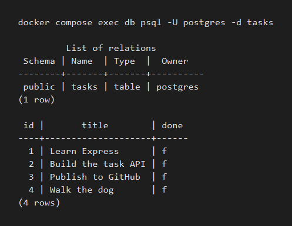

# Task API

A small to-do API. You can create, read, update, and delete tasks. The app and Postgres both run in Docker. One command starts them.

## Run

Copy `.env.example` to `.env`. That file has the database name, user, password, and `DATABASE_URL`. The password is not written in the code.

```bash
docker compose up --build
```

Compose reads `POSTGRES_USER`, `POSTGRES_PASSWORD`, and `POSTGRES_DB` from `.env`. It starts Postgres and sets the app's `DATABASE_URL` to the `db` service on the Docker network. The API listens at [http://localhost:3000](http://localhost:3000). Swagger UI is at [http://localhost:3000/docs](http://localhost:3000/docs).

`npm start` still runs the app on the host. For that, Postgres has to be reachable at the `DATABASE_URL` in `.env`. On this PC, Windows already uses port 5432, so a hand-run container was published on 5433. Compose does not need that host port.

## Endpoints

| Method | Path | Success | Failure |
| --- | --- | --- | --- |
| GET | `/` | 200, API name and version | |
| GET | `/health` | 200, `{ "status": "ok" }` | |
| GET | `/tasks` | 200, the full list | |
| GET | `/tasks/:id` | 200, one task | 404 if the id is unknown |
| POST | `/tasks` | 201, the created task | 400 if `title` is missing or blank |
| PUT | `/tasks/:id` | 200, the updated task | 400 if the body is empty, the title is blank, or `done` is not true or false. 404 if the id is unknown |
| DELETE | `/tasks/:id` | 204, empty body | 404 if the id is unknown |

`POST` sends `{ "title": "Buy milk" }`. The server sets `id` and `done: false`.

`PUT` sends `title`, `done`, or both. A missing field stays as it was.

## The same requests, a third time

The routes are the same as the in-memory version and the SQLite version. A task used to live in a list, then in `tasks.db`, and now in Postgres. The JSON still uses `done: true` or `done: false`. A missing title is still 400. An unknown id is still 404, with the message `Task 999 not found`. Delete is still 204. The client talks to the API. It does not talk to the database.

Values go into SQL as `$1` placeholders. They are not pasted into the query string.

The `tasks` table is created on startup if it is missing. The three example tasks are inserted only when the table is empty. I created "Walk the dog" with POST, ran `docker compose down`, then `docker compose up`. The row was still there. The volume keeps the data. `docker compose down` does not delete it.

## Rows in Postgres

```bash
docker compose exec db psql -U postgres -d tasks
```

`\dt` lists `public.tasks`. This select shows the three example tasks plus "Walk the dog":

```sql
SELECT id, title, done FROM tasks ORDER BY id;
```



## Example

```text
curl -i -X POST http://localhost:3000/tasks -H "Content-Type: application/json" -d "{\"title\":\"Walk the dog\"}"
```

```text
HTTP/1.1 201 Created
X-Powered-By: Express
Content-Type: application/json; charset=utf-8
Content-Length: 44
ETag: W/"2c-AEsVWZKGtxvNZzOYAG2K9pw4/n0"
Date: Wed, 28 Oct 2026 20:58:48 GMT
Connection: keep-alive
Keep-Alive: timeout=5

{"id":4,"title":"Walk the dog","done":false}
```

## Swagger UI


