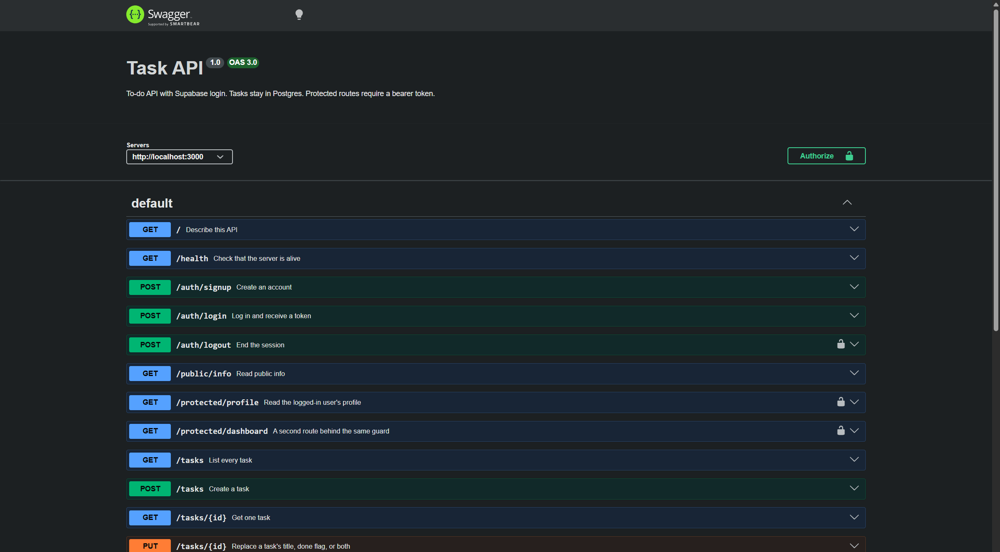

# Task API

A small to-do API with login. You can create, read, update, and delete tasks. Tasks stay in Postgres. Accounts and tokens come from Supabase. This API never stores a password.

## Run

Copy `.env.example` to `.env` and fill in the Supabase values.

`SUPABASE_URL` is the project URL, like `https://your-project.supabase.co`. `SUPABASE_KEY` is the publishable key. On an older project that key is called the anon key. Do not put the secret key or the service_role key in the file.

In the Supabase dashboard, open Authentication → Sign In / Providers → Email. Turn the email provider on, and turn Confirm email off. A new user can then log in immediately.

Postgres still comes from Docker. One command starts the API and the database:

```bash
docker compose up --build
```

Compose reads `POSTGRES_USER`, `POSTGRES_PASSWORD`, `POSTGRES_DB`, `SUPABASE_URL`, and `SUPABASE_KEY` from `.env`. It points the app at the `db` service, so the database password is not written in the code. The API listens at [http://localhost:3000](http://localhost:3000). Swagger UI is at [http://localhost:3000/docs](http://localhost:3000/docs).

`npm start` runs the app on the host. For that, Postgres has to be reachable at the `DATABASE_URL` in `.env`. On this PC, Windows already uses port 5432, so a hand-run container was published on 5433. Compose does not need that host port.

## Auth

`POST /auth/signup` and `POST /auth/login` send the email and password to Supabase. Login returns an `access_token` and a `refresh_token`. Protected routes expect `Authorization: Bearer <token>`. One middleware checks that header and asks Supabase if the token is real. The same guard is on `/protected/profile`, `/protected/dashboard`, and `/auth/logout`.

A missing or malformed header is 401, `{ "error": "Access token required" }`. A forged or expired token is 401, `{ "error": "Invalid or expired token" }`. A missing email or password is 400. A wrong password is 401, `{ "error": "Invalid login credentials" }`. Logout is 204.

## Endpoints

| Method | Path | Auth | Success | Failure |
| --- | --- | --- | --- | --- |
| POST | `/auth/signup` | no | 201, the new user | 400 if email or password is missing, or Supabase rejects the signup |
| POST | `/auth/login` | no | 200, access token and refresh token | 400 if email or password is missing. 401 if the credentials are wrong |
| POST | `/auth/logout` | bearer | 204, empty body | 401 if the token is missing or invalid |
| GET | `/protected/profile` | bearer | 200, id, email, and created_at | 401 if the token is missing or invalid |
| GET | `/protected/dashboard` | bearer | 200, a short message | 401 if the token is missing or invalid |
| GET | `/public/info` | no | 200, a public message | |
| GET | `/` | no | 200, API name and version | |
| GET | `/health` | no | 200, `{ "status": "ok" }` | |
| GET | `/tasks` | no | 200, the full list | |
| GET | `/tasks/:id` | no | 200, one task | 404 if the id is unknown |
| POST | `/tasks` | no | 201, the created task | 400 if `title` is missing or blank |
| PUT | `/tasks/:id` | no | 200, the updated task | 400 if the body is empty, the title is blank, or `done` is not true or false. 404 if the id is unknown |
| DELETE | `/tasks/:id` | no | 204, empty body | 404 if the id is unknown |

`POST /tasks` sends `{ "title": "Buy milk" }`. The server sets `id` and `done: false`.

`PUT` sends `title`, `done`, or both. A missing field stays as it was.

## Swagger

The lock icon is on the routes that need a token. Click Authorize, paste the access token from login, and Try it out on `/protected/profile`.



## Example

A signup with no password:

```text
curl -i -X POST http://localhost:3000/auth/signup -H "Content-Type: application/json" -d "{\"email\":\"test@example.com\"}"
```

```text
HTTP/1.1 400 Bad Request
Content-Type: application/json; charset=utf-8

{"error":"email and password are required"}
```

The public route needs no token:

```text
curl -i http://localhost:3000/public/info
```

```text
HTTP/1.1 200 OK
Content-Type: application/json; charset=utf-8

{"message":"Welcome stranger! This info is public."}
```

The profile route with no token:

```text
curl -i http://localhost:3000/protected/profile
```

```text
HTTP/1.1 401 Unauthorized
Content-Type: application/json; charset=utf-8

{"error":"Access token required"}
```

## Tasks

The task routes are the same as the in-memory version and the SQLite version. A task used to live in a list, then in `tasks.db`, and now in Postgres. The JSON still uses `done: true` or `done: false`. An unknown id is still 404, with the message `Task 999 not found`.

Values go into SQL as `$1` placeholders. They are not pasted into the query string.

The `tasks` table is created on startup if it is missing. The three example tasks are inserted only when the table is empty. I created "Walk the dog" with POST, ran `docker compose down`, then `docker compose up`. The row was still there.


