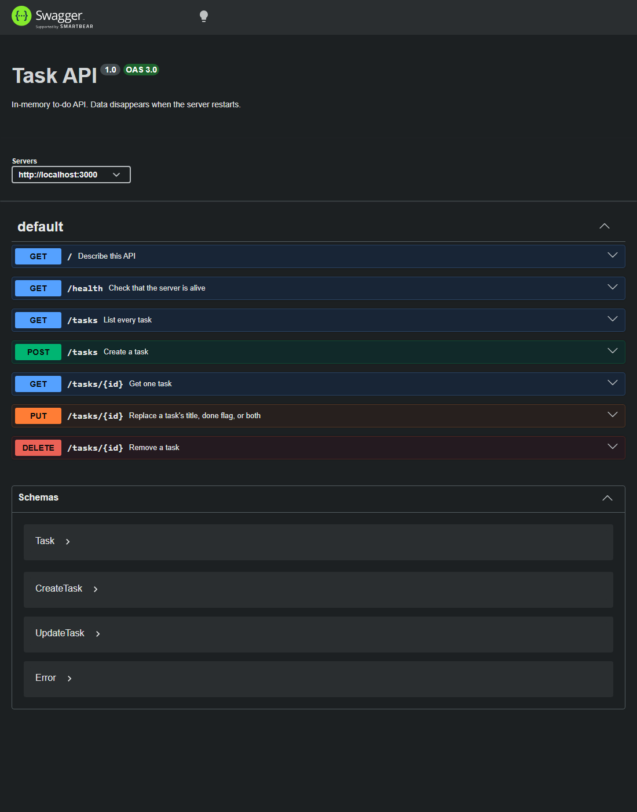

# Task API

A small to-do API. You can create, read, update, and delete tasks. The list lives in memory. Restarting the server drops anything you added and brings back the three example tasks.

## Run

One command after install:

```bash
npm install
npm start
```

The server listens at [http://localhost:3000](http://localhost:3000).

Swagger UI is at [http://localhost:3000/docs](http://localhost:3000/docs).

## Endpoints

| Method | Path | Success | Failure |
| --- | --- | --- | --- |
| GET | `/` | 200, API name and version | |
| GET | `/health` | 200, `{ "status": "ok" }` | |
| GET | `/tasks` | 200, the full list | |
| GET | `/tasks/:id` | 200, one task | 404 if the id is unknown |
| POST | `/tasks` | 201, the created task | 400 if `title` is missing or blank |
| PUT | `/tasks/:id` | 200, the updated task | 400 if the body is empty or the title is blank, 404 if the id is unknown |
| DELETE | `/tasks/:id` | 204, empty body | 404 if the id is unknown |

`POST` sends `{ "title": "Buy milk" }`. The server sets `id` and `done: false`.

`PUT` sends `title`, `done`, or both. A missing field stays as it was.

## Example

```text
curl -i -X POST http://localhost:3000/tasks -H "Content-Type: application/json" -d "{\"title\":\"Buy milk\"}"
```

```text
HTTP/1.1 201 Created
X-Powered-By: Express
Content-Type: application/json; charset=utf-8
Content-Length: 40
ETag: W/"28-PpSBYV7i68cXyGc7AhjVpkZkY5Q"
Date: Thu, 22 Oct 2026 08:59:59 GMT
Connection: keep-alive
Keep-Alive: timeout=5

{"id":4,"title":"Buy milk","done":false}
```

## Swagger UI


